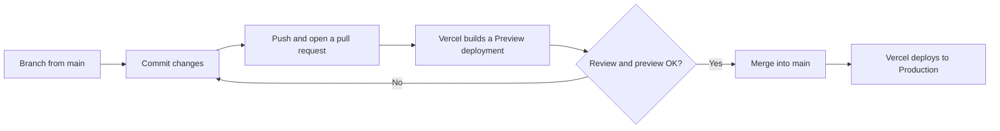

# Contributing

Thank you for helping to maintain the ESN Ukraine website. This guide describes how code and documentation changes move from an idea to production.

**Audience:** volunteer developers working on this repository. If you want to publish news, events or other content, you do not need to change code — see the [content editing guide](docs/content-editing/README.md).

## Before you start

1. Set up the project locally by following [Getting started](docs/getting-started.md).
2. Ask the current maintainer for the access you need:
   - write access to this GitHub repository;
   - membership in the Sanity project (for Studio and API tokens);
   - optionally, access to the Vercel project (deployments, logs, environment variables).
3. Skim the [architecture overview](docs/architecture/overview.md) so that you know where things live.

## Workflow



### 1. Create a branch

Always branch from an up-to-date `main`:

```bash
git switch main
git pull
git switch -c feature/short-description
```

Use the prefixes that already exist in this repository:

| Prefix | Use for |
|---|---|
| `feature/` or `feat/` | New pages, sections or capabilities |
| `fix/` | Bug fixes |
| `refactor/` | Code restructuring without behaviour changes |
| `perf/` | Performance work |
| `docs/` | Documentation only |
| `chore/` | Dependencies, configuration, housekeeping |
| `experiment/` | UI experiments that may be discarded |

### 2. Commit with Conventional Commits

Write commit messages as `type(scope): summary` in the imperative mood. The history uses these types: `feat`, `fix`, `style`, `refactor`, `perf`, `chore` and `docs`. Examples from the history:

```text
feat: add gallery lightbox with fullscreen zoom, keyboard/swipe navigation
fix(newsletter): rename honeypot to trap bots and remove PII from logs
style(attachments): optimize preview modal for mobile devices
```

The scope is optional. Use the area you changed, for example `sanity`, `newsletter`, `hero`, `sections` or `attachments`.

### 3. Open a pull request

Push your branch and open a pull request against `main`. The [pull request template](.github/pull_request_template.md) contains the checklist. In the description:

- explain **what** changed and **why**;
- add screenshots for visual changes, both desktop and mobile;
- mention new environment variables or Sanity schema changes.

### 4. Check the Preview deployment

Vercel builds every pushed branch and links the Preview deployment in the pull request. Check the pages you changed on desktop and on a phone. Several past bugs affected only iOS Safari, so test there if you can.

> [!NOTE]
> Sanity Studio always edits real content in the dataset it is connected to. Unless the Vercel Preview environment uses a separate dataset (**to confirm** in Vercel → Settings → Environment Variables), content you publish while testing appears on the live website too.

### 5. Merge

When the pull request is reviewed and the preview looks right, merge it. The history uses merge commits (`Merge pull request #…`). Vercel deploys `main` to production automatically. Afterwards, delete the branch.

## Local checks

Run these commands in `esn-ukraine-web/` before you push:

```bash
npm run lint       # ESLint (Next.js core-web-vitals and TypeScript rules)
npx tsc --noEmit   # TypeScript type check
npm run build      # Production build; needs the Sanity variables and network access
```

> [!IMPORTANT]
> `npm run build` does not run ESLint, and the codebase has some existing lint errors. Compare the lint output before and after your change, and do not add new errors.

## Code conventions

- **Server Components by default.** Add `'use client'` only to components that need state, effects or browser APIs. Keep client components small and pass them plain data as props.
- **File naming.** Interactive page sections in `components/sections/` use the `.client.tsx` suffix. Other folders do not use it consistently, so check the first line of a file for `'use client'`.
- **Imports.** Use the `@/` alias, which points to the `esn-ukraine-web/` folder, for example `@/sanity/lib/fetch`.
- **Data fetching.** Fetch Sanity data in Server Components with `sanityFetch` from `@/sanity/lib/fetch`. Pass the document type as a cache tag, for example `tags: ['news']`, so the revalidation webhook can refresh the page. Put reusable GROQ queries in `sanity/lib/queries.ts` and their result types in `sanity/lib/types.ts`.
- **Styling.** Use Tailwind utility classes and the ESN colour tokens (`esn-cyan`, `esn-magenta`, `esn-green`, `esn-dark`, `esn-navy`). See [Styling](docs/reference/styling.md).
- **Images.** Use `next/image`. Remote hosts must be allowed in `images.remotePatterns` in `next.config.ts`.
- **Language.** Website copy is in English. Sanity Studio labels, descriptions and validation messages are in Ukrainian, because editors work in Ukrainian. Keep both conventions.
- **Secrets.** Never commit secrets or real environment values. Add every new variable to [`esn-ukraine-web/.env.example`](esn-ukraine-web/.env.example) and to the [environment variable reference](docs/reference/environment-variables.md).

## Documentation

Documentation is part of the change. Update it in the same pull request. The [maintenance map](docs/README.md#keeping-the-documentation-up-to-date) lists which page to update for each kind of change. For significant technical decisions, add an [architecture decision record](docs/adr/README.md).

The repository is public, so never include secrets, environment variable values or personal data in documentation.

## Reporting problems

- **Bugs and ideas:** open a GitHub issue. Describe what you expected, what happened, and the page URL and device.
- **Security vulnerabilities:** do **not** open a public issue. Follow [SECURITY.md](SECURITY.md).

## Licence

By contributing, you agree that your contributions are released under the [MIT License](LICENSE). Brand assets, photos and other media are not covered by the licence, as explained in the [README](README.md#licence). Add such files only if ESN Ukraine has permission to use them.
