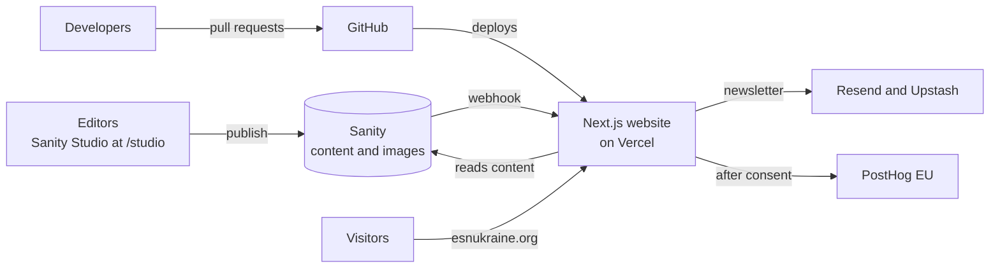

<div align="center">

<picture>
  <source media="(prefers-color-scheme: dark)" srcset="https://raw.githubusercontent.com/MaksymKorchynskyi/new-website-esnukraine/main/esn-ukraine-web/public/logo-esn-ukraine-white.png">
  
</picture>

# ESN Ukraine website

**Erasmus Student Network Ukraine** · *Students Helping Students*

[](https://esnukraine.org)
[](docs/guides/deployment-and-environments.md)
[](https://github.com/MaksymKorchynskyi/new-website-esnukraine/commits/main)

[](esn-ukraine-web/package.json)
[](esn-ukraine-web/package.json)
[](esn-ukraine-web/package.json)
[](esn-ukraine-web/package.json)
[](esn-ukraine-web/package.json)
[](docs/getting-started.md#prerequisites)

[Website](https://esnukraine.org) · [Documentation](docs/README.md) · [Getting started](docs/getting-started.md) · [Content editing](docs/content-editing/README.md) · [Contributing](CONTRIBUTING.md)

</div>

Source code of [esnukraine.org](https://esnukraine.org), the official website of **Erasmus Student Network Ukraine** — the national student organisation that represents ESN sections in Ukraine and supports international students under the motto *Students Helping Students*.

The site publishes news, events, information about the National Board and local sections, Erasmus+ opportunities and the ESNcard. Editors manage most dynamic content in **Sanity Studio**, which is embedded in the website at `/studio`.

| | |
|---|---|
| **Production** | <https://esnukraine.org> (deployed automatically from `main`) |
| **Content editing** | <https://esnukraine.org/studio> (requires a Sanity account with access to the project) |
| **Framework** | Next.js 16 (App Router), React 19, TypeScript |
| **CMS** | Sanity (Studio 4, embedded with `next-sanity`) |
| **Styling** | Tailwind CSS 3 |
| **Hosting** | Vercel (Preview deployment for every branch, Production from `main`) |

Exact dependency versions are in [`esn-ukraine-web/package.json`](esn-ukraine-web/package.json).

## Features

- **Editor-friendly content management.** Volunteers manage news, events, the National Board, former boards, sections and homepage photos in Sanity Studio. The Studio uses Ukrainian labels and checks uploads automatically. See the [content editing guide](docs/content-editing/README.md).
- **Pre-rendered pages with quick content updates.** Pages are rendered in advance and cached on Vercel. A publish webhook refreshes them, usually within seconds. See [Rendering and data flow](docs/architecture/rendering-and-data-flow.md).
- **Rich articles and event pages.** Formatted text, inline photos and photo rows, file attachments with a PDF preview, and photo galleries with a full-screen viewer. See the [content model](docs/reference/content-model.md).
- **Homepage Spotlight.** Editors choose which news and events appear in the homepage slider. See [Homepage, people and sections](docs/content-editing/homepage-people-and-sections.md).
- **Newsletter sign-up.** Subscribers are stored in Resend. The form is protected by an origin check, rate limiting and a honeypot field. See the [API reference](docs/reference/api.md#post-apinewslettersubscribe).
- **Cookie consent and opt-in analytics.** The consent banner shows "Accept All" and "Reject All" side by side. PostHog (EU Cloud) tracks only after consent. See [Privacy and analytics](docs/architecture/privacy-and-analytics.md).
- **Search engine support.** Metadata, a sitemap, structured data, and 43 permanent redirects from the previous Drupal website. See [SEO](docs/architecture/seo.md).
- **Erasmus+ information hub.** Six pages explain Erasmus+ opportunities for Ukrainian students. See [Routes](docs/reference/routes.md).

## Quick start

Requirements: Node.js 22.12 or newer (20.19+ also works), npm, and the Sanity project ID and dataset name. See [Getting started](docs/getting-started.md) for details.

```bash
git clone https://github.com/MaksymKorchynskyi/new-website-esnukraine.git
cd new-website-esnukraine/esn-ukraine-web
npm ci
cp .env.example .env.local   # then fill in the values
npm run dev
```

Open <http://localhost:3000> for the website and <http://localhost:3000/studio> for Sanity Studio.

## Architecture at a glance



The website is a single Next.js application. Content comes from Sanity, and there is no database or server of our own to maintain. For the full picture, read the [architecture overview](docs/architecture/overview.md).

## Repository structure

```text
.
├── README.md                 ← you are here
├── CONTRIBUTING.md           ← how to propose changes
├── SECURITY.md               ← how to report a vulnerability
├── docs/                     ← project documentation
└── esn-ukraine-web/          ← the Next.js application (Vercel builds this folder)
    ├── app/                  ← routes: public website, /studio, API routes, sitemap, robots
    ├── components/           ← React components (layout, page sections, UI, analytics)
    ├── lib/                  ← navigation config and cookie-consent helpers
    ├── sanity/               ← CMS schemas, Studio structure, GROQ queries, data fetching
    ├── public/               ← static files (images, video, map)
    └── next.config.ts        ← images, redirects from the old site, analytics proxy
```

## Documentation

Start with the [documentation home](docs/README.md). It has reading paths for each role.

| I want to… | Read |
|---|---|
| Set up the project and make my first change | [Getting started](docs/getting-started.md) |
| Understand how the system works | [Architecture overview](docs/architecture/overview.md) |
| Look up a route, API, schema or setting | [Reference](docs/README.md#reference) |
| Do a specific development task | [Guides](docs/README.md#how-to-guides-for-developers-and-maintainers) |
| Publish news, events or other content | [Content editing guide](docs/content-editing/README.md) |
| Take over maintenance of the website | [Handover checklist](docs/operations/handover-checklist.md) |
| Understand why things were built this way | [Architecture decision records](docs/adr/README.md) |

## How changes go live

- **Code:** open a pull request against `main`. Vercel builds a Preview deployment for the branch. After review, merging into `main` deploys to Production automatically. See [Deployment and environments](docs/guides/deployment-and-environments.md).
- **Content:** publishing a document in Sanity Studio triggers a webhook that refreshes the affected pages, usually within seconds. Pages also refresh at least once an hour. See [Rendering and data flow](docs/architecture/rendering-and-data-flow.md).

## Contributing and support

- Read [CONTRIBUTING.md](CONTRIBUTING.md) before opening a pull request.
- Report security issues privately as described in [SECURITY.md](SECURITY.md). Do not open public issues for them.
- Technical questions about the website: <web-master@esnukraine.org>. General enquiries about ESN Ukraine: <ukraine-nr@esn.org>.
