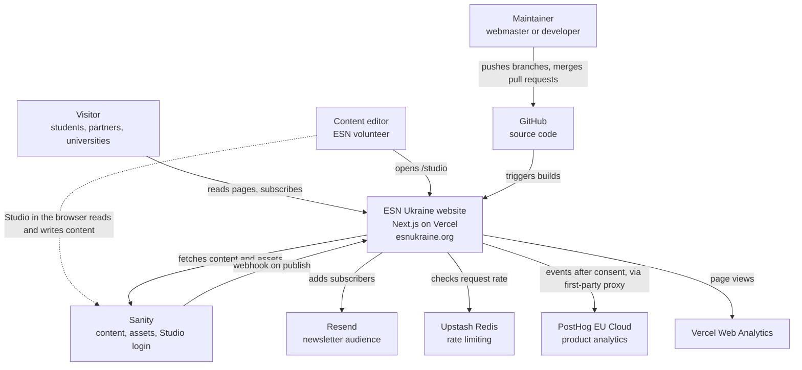
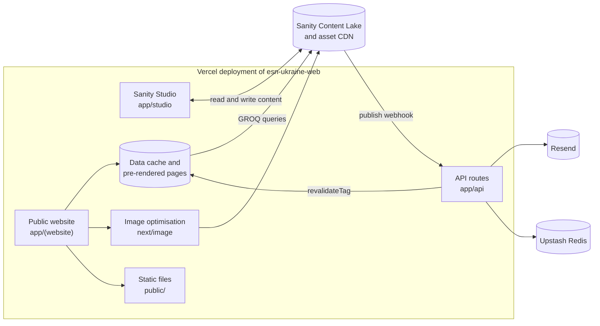
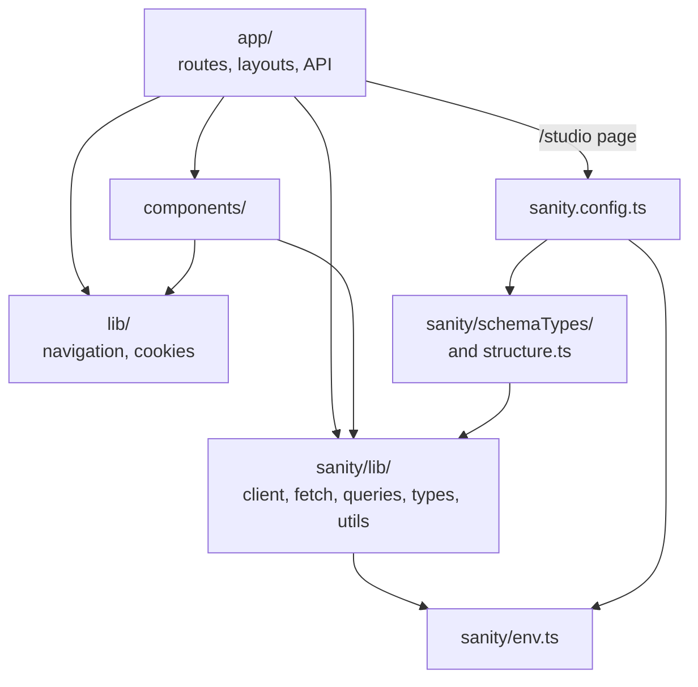

# Architecture overview

This page describes the ESN Ukraine website as a whole: the context it runs in, its main building blocks, how the code is organised, and which content lives in the CMS and which in code. More detailed explanations are on the linked pages.

**Audience:** developers and maintainers who need the big picture before they change something.

## Context and constraints

The website is the public face of ESN Ukraine, a national volunteer-run student organisation. Several characteristics of the organisation shape the technical design:

| Constraint | Consequence for the design |
|---|---|
| **Volunteer maintainers who change regularly** | A mainstream, well-documented stack (Next.js, Sanity, Vercel) and no custom servers or databases to look after. |
| **Non-technical, Ukrainian-speaking editors** | A headless CMS with a friendly editor (Sanity Studio). Field labels, help texts and validation messages are in Ukrainian. |
| **Little or no budget** | Static generation with caching keeps hosting and CMS usage low. The Studio warns editors about image sizes to stay within storage limits. |
| **International audience** | Public website copy is in English. |
| **Personal data of EU and Ukrainian users** | Opt-in analytics with a cookie consent banner, an EU analytics region, and no email addresses in server logs. See [Privacy and analytics](privacy-and-analytics.md). |
| **Search visibility after replacing the old site** | Server-rendered HTML, a sitemap, metadata, and permanent redirects from the previous Drupal website. See [SEO](seo.md). |

## System context



- **Visitors** read server-rendered pages and can subscribe to the newsletter.
- **Editors** open Sanity Studio at `/studio`. The Studio is a browser application that talks to Sanity's API directly. Publishing a document triggers a **webhook** that refreshes the cached pages.
- **Maintainers** change code through GitHub. Vercel builds every branch and deploys `main` to production.

## Building blocks

All application code is in one Next.js project in the `esn-ukraine-web/` folder, deployed to Vercel as a single project.



| Building block | Location | Responsibility |
|---|---|---|
| Public website | `app/(website)/` | All public pages, rendered on the server as static or incrementally regenerated pages. One root layout provides the header, footer, cookie banner and analytics. |
| Sanity Studio | `app/studio/`, `sanity.config.ts` | The content editing application, served at `/studio`. It has its own root layout and is excluded from search engines. |
| API routes | `app/api/` | Cache revalidation webhook, draft mode on/off, and newsletter subscription (Edge runtime). See [API](../reference/api.md). |
| Content model | `sanity/schemaTypes/` | Document types and validation used by the Studio. See [Content model](../reference/content-model.md). |
| Data access | `sanity/lib/` | Sanity client, `sanityFetch`, GROQ queries, result types, image URL builder and date formatting. |
| Components | `components/` | Layout (header, footer, cookie UI), interactive page sections, reusable UI and analytics providers. See [Components](../reference/components.md). |
| Configuration | `lib/navigation.tsx`, `next.config.ts`, `tailwind.config.ts` | Navigation and social links, image hosts, redirects, analytics proxy and design tokens. See [Configuration](../reference/configuration.md). |
| Static files | `public/` | Logos, photos, the section map, the "This is ESN Ukraine" video and the default social sharing image. |

## Technology stack

| Concern | Technology | Configured in |
|---|---|---|
| Framework | Next.js 16 with the App Router, React 19 | `next.config.ts`, `app/` |
| Language | TypeScript 5 (strict mode) | `tsconfig.json` |
| Styling | Tailwind CSS 3 with the typography plugin | `tailwind.config.ts`, `app/globals.css` |
| Fonts | Manrope via `next/font/google` (Latin and Cyrillic subsets) | `app/(website)/layout.tsx` |
| CMS | Sanity Studio 4 embedded with `next-sanity` | `sanity.config.ts`, `sanity/` |
| Rich text rendering | `@portabletext/react` | `app/(website)/news/[slug]/page.tsx`, `app/(website)/events/[slug]/page.tsx` |
| Animations | Framer Motion and CSS keyframes | Components; `tailwind.config.ts` |
| Icons | `lucide-react` | Components |
| Newsletter | Resend, Upstash Redis with `@upstash/ratelimit`, Zod validation | `app/api/newsletter/subscribe/route.ts` |
| Analytics | PostHog (EU Cloud, opt-in), Vercel Web Analytics | `components/analytics/`, `app/(website)/layout.tsx` |
| Hosting | Vercel | Vercel project settings (not stored in the repository) |
| Linting | ESLint 9 with `eslint-config-next` | `eslint.config.mjs` |

Exact versions are in [`package.json`](../../esn-ukraine-web/package.json). The [Configuration reference](../reference/configuration.md) lists every dependency and where it is used.

## Repository structure

```text
esn-ukraine-web/
├── app/
│   ├── (website)/            # public website (route group with its own root layout)
│   │   ├── layout.tsx        # <html>, fonts, Header, Footer, CookieBanner, analytics, default metadata
│   │   ├── page.tsx          # homepage
│   │   ├── error.tsx  loading.tsx  not-found.tsx
│   │   ├── news/  events/    # listings and [slug] detail pages (CMS)
│   │   ├── national-board/  our-sections/  about-us/   # incl. about-us/former-boards (CMS)
│   │   ├── erasmus/          # Erasmus+ pages (content in code)
│   │   ├── for-students/     # ESNcard and placeholder pages
│   │   ├── contact/  privacy/  cookies/  blog/  projects/
│   ├── studio/               # Sanity Studio (route group with its own root layout)
│   ├── api/                  # revalidate, draft-mode/enable, draft-mode/disable, newsletter/subscribe
│   ├── sitemap.ts  robots.ts # sitemap.xml and robots.txt
│   ├── globals.css
│   └── icon.png  apple-icon.png  favicon.ico
├── components/
│   ├── layout/               # Header, Footer, LanguageSwitcher, CookieBanner, CookieSettings
│   ├── sections/             # *.client.tsx: Hero, Events, NetworkCollage, NewsletterForm, Board
│   ├── ui/                   # Card, AttachmentFiles, PhotoGalleryLightbox, PolicyPageLayout, UkraineMap, UnderDevelopment
│   └── analytics/            # PostHogProvider, PostHogPageView
├── lib/
│   ├── navigation.tsx        # header menu, footer links, social links
│   └── cookies.ts            # cookie consent state and events
├── sanity/
│   ├── schemaTypes/          # 8 document types
│   ├── lib/                  # client, fetch, queries, types, image, imageValidation, utils
│   ├── structure.ts          # Studio sidebar
│   └── env.ts                # project ID, dataset, API version
├── public/                   # static assets
├── sanity.config.ts  sanity.cli.ts
├── next.config.ts  tailwind.config.ts  postcss.config.mjs  eslint.config.mjs  tsconfig.json
└── package.json  package-lock.json  .env.example
```

## Module boundaries

Dependencies point in one direction. Lower layers never import from higher ones:



Rules that keep the code easy to follow:

- **Data fetching happens in Server Components** (pages and layouts) through `sanityFetch`. It uses `next/headers`, so it cannot run in the browser.
- **Client Components receive plain props.** Interactive parts are Client Components (`'use client'`): the header, footer, cookie UI, sliders, forms, galleries and modals. Most of them live in `components/`. The exceptions are the About Us and Contact pages, which are Client Components as a whole.
- **Schemas are used only by the Studio.** The website reads content through GROQ queries, not through the schema definitions.

## What is managed where

Most dynamic content is edited in Sanity Studio. Some pages and texts are part of the code and need a developer to change:

| Managed in **Sanity Studio** (editors) | Managed in **code** (developers) |
|---|---|
| News articles and their categories | Header menu, footer links and social links (`lib/navigation.tsx`) |
| Events and their categories | Homepage texts: "This is ESN Ukraine", "Our Network", "Stay Connected" and the hashtag ticker (`app/(website)/page.tsx`) |
| Homepage hero slides (the **Spotlight** switch on news and events) | About Us page: texts, statistics, history photos and video |
| Homepage "Our Network" photos | Erasmus+ section (6 pages under `app/(website)/erasmus/`) |
| National Board members | ESNcard page |
| Former boards | Contact page (contact details and social links) |
| ESN sections (cards on "Our Sections") | Privacy Policy and Cookie Policy |
| | Section map image (`public/ESN Ukraine section map.webp`) |
| | Board group headings such as "The Board 2025-26" |
| | Placeholder pages: Projects, Blog, Buddy System, Housing, Survival Guide |

For content that lives in code, see [Common tasks](../guides/common-tasks.md#edit-content-that-lives-in-code).

## Key runtime flows

- **Page requests and content updates:** pages are pre-rendered and cached. A publish in Sanity invalidates the cache through a webhook, and every cached page also expires after one hour. See [Rendering and data flow](rendering-and-data-flow.md).
- **Newsletter subscription:** the browser posts to an Edge API route, which checks the origin, rate-limits by IP address, validates the input and adds the contact to a Resend audience. See [API](../reference/api.md#post-apinewslettersubscribe).
- **Analytics:** PostHog starts in opted-out mode and tracks only after the visitor accepts analytics cookies. See [Privacy and analytics](privacy-and-analytics.md).

## Related

- [Rendering and data flow](rendering-and-data-flow.md)
- [Routes](../reference/routes.md)
- [Deployment and environments](../guides/deployment-and-environments.md)
- [Architecture decision records](../adr/README.md)
