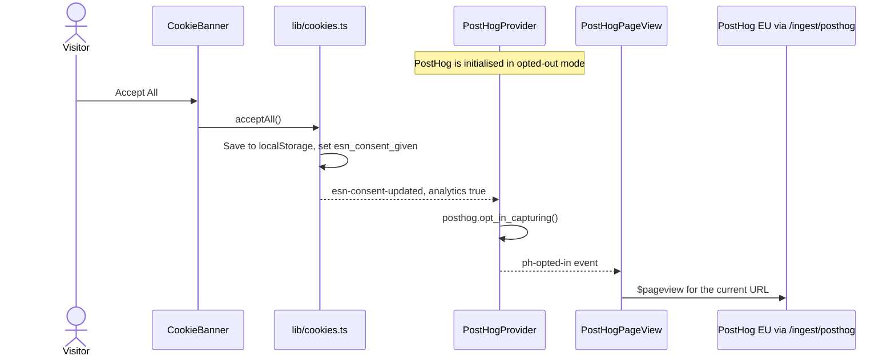

# Privacy and analytics

This page describes, from a technical point of view, which personal data the website processes, how cookie consent works, and how the analytics tools are connected. It does not replace the legal texts: the [Privacy Policy](https://esnukraine.org/privacy) and the [Cookie Policy](https://esnukraine.org/cookies) are the authoritative documents for visitors.

**Audience:** developers who touch analytics, forms or cookies, and maintainers who keep the policies accurate.

> [!IMPORTANT]
> The policy pages are code (`app/(website)/privacy/page.tsx` and `app/(website)/cookies/page.tsx`). Whenever you add, remove or reconfigure anything that processes personal data, update the matching policy page and its `lastUpdated` date in the same pull request.

## Overview of data flows

| Data | Collected by | Sent to | Purpose |
|---|---|---|---|
| Cookie consent choice | Cookie banner and settings | The visitor's browser only (`localStorage` and a cookie) | Remember the choice |
| Usage analytics (page views, events) | PostHog, **only after the visitor opts in** | PostHog EU Cloud, through the website's own domain | Understand how the website is used |
| Page views and performance metrics | Vercel Web Analytics (`<Analytics />`) | Vercel | Traffic statistics |
| Email address | Newsletter form | Resend audience | Sending the newsletter |
| IP address | Newsletter API | Upstash Redis (rate-limit counter) | Spam and abuse protection |
| Contact form fields | Contact page | **Nowhere.** The form is UI-only and is not connected to a backend. | — |
| Names, photos and roles of board members | Editors in Sanity Studio | Sanity, published on the website | National Board and former boards pages |

## Cookie consent

Consent is handled by a small in-house implementation without external dependencies. See [ADR-0005](../adr/0005-in-house-cookie-consent-and-eu-analytics.md).

### Categories

Defined in `COOKIE_CATEGORIES` in [`lib/cookies.ts`](../../esn-ukraine-web/lib/cookies.ts):

| Category | Can be disabled | Description |
|---|---|---|
| `essential` | No | Required for the website to work, including remembering the consent choice |
| `analytics` | Yes. Off until the visitor accepts it | Usage analytics |

### Storage

| Name | Type | Content | Lifetime |
|---|---|---|---|
| `esn-cookie-consent` | `localStorage` | JSON, for example `{"essential":true,"analytics":false}` | Until the visitor clears site data |
| `esn_consent_given` | Cookie (`path=/`, `SameSite=Lax`) | `1` | 365 days |

`localStorage` is the source of truth. The cookie is meant to let server code know that consent was given, but no server code reads it at the moment.

### Components and events

| Piece | File | Role |
|---|---|---|
| Consent API | `lib/cookies.ts` | `getConsent`, `setConsent`, `acceptAll`, `rejectAll`, `hasConsentBeenGiven`; dispatches events |
| Banner | `components/layout/CookieBanner.tsx` | Shown until a choice is stored. Buttons: **Accept All**, **Reject All** (equally prominent) and **Manage Preferences** |
| Settings dialog | `components/layout/CookieSettings.tsx` | Toggle for analytics, **Save Preferences** and **Accept All**. Has a focus trap and closes with <kbd>Esc</kbd> |
| Settings button | `app/(website)/cookies/CookieSettingsButton.tsx` | "Manage Cookie Settings" on the Cookie Policy page; opens the dialog |

Two browser events connect these pieces:

| Event | Dispatched when | Listened to by |
|---|---|---|
| `esn-consent-updated` (`detail` = consent state) | Consent is saved | `PostHogProvider` |
| `esn-open-cookie-settings` | The settings button is clicked | `CookieBanner`, which opens the dialog |

## PostHog (product analytics)

PostHog is set up in [`components/analytics/PostHogProvider.tsx`](../../esn-ukraine-web/components/analytics/PostHogProvider.tsx). It is initialised in the browser when `NEXT_PUBLIC_POSTHOG_KEY` is set:

| Option | Value | Effect |
|---|---|---|
| `api_host` | `/ingest/posthog` | Requests go to the website's own domain. A rewrite in `next.config.ts` forwards them to `https://eu.i.posthog.com` (EU region). |
| `ui_host` | `https://eu.posthog.com` | Links in the toolbar point to the EU app |
| `opt_out_capturing_by_default` | `true` | Nothing is captured until the visitor opts in |
| `capture_pageview` | `false` | Page views are sent manually (see below) |
| `disable_session_recording` | `true` | No session recordings |

- On page load, `PostHogProvider` reads the stored consent and opts in or out accordingly.
- [`PostHogPageView`](../../esn-ukraine-web/components/analytics/PostHogPageView.tsx) sends a `$pageview` on every route change, but only while capturing is not opted out. It also listens to the internal `ph-opted-in` event to record the current page right after the visitor opts in.
- If `NEXT_PUBLIC_POSTHOG_KEY` is missing, PostHog logs a warning in the browser console and stays inactive.

## Vercel Web Analytics

The root layout `app/(website)/layout.tsx` renders `<Analytics />` from `@vercel/analytics` for every visitor. It is not connected to the consent state.

> [!NOTE]
> The Cookie Policy lists Vercel Analytics in the **Analytics** category. When you change how analytics are loaded, keep the implementation and the policy consistent.

## Newsletter data

The newsletter API is described in detail in the [API reference](../reference/api.md#post-apinewslettersubscribe). From a data protection point of view:

- The form requires the visitor to tick the privacy consent checkbox. The API rejects requests where `consent` is not `true`. The consent value itself is not stored.
- The email address is trimmed, lowercased and added to the Resend audience as a subscribed contact. There is no confirmation email (single opt-in).
- The visitor's IP address is the key for the rate limiter (5 requests per minute per IP address). Upstash stores it in short-lived counters.
- Server logs never contain email addresses. They record blocked origins, missing configuration and errors.
- A hidden "honeypot" field catches simple bots. Requests that fill it in get a success response but are not subscribed.

## Content about people

Board member and former board documents contain names, positions and photos that are published on the website. The `boardMember` type also has optional `description`, `section`, `email` and `linkedin` fields. The National Board page fetches these fields and includes them in the data sent to the browser, although it currently does not display them. Editors should only enter information that may be public. See the [content editing guide](../content-editing/homepage-people-and-sections.md#national-board).

## Related

- [Privacy Policy page source](../../esn-ukraine-web/app/(website)/privacy/page.tsx) and [Cookie Policy page source](../../esn-ukraine-web/app/(website)/cookies/page.tsx)
- [Services and accounts](../operations/services-and-accounts.md): the processors behind each data flow
- [ADR-0004: Newsletter via Resend with rate limiting](../adr/0004-newsletter-via-resend-with-rate-limiting.md)
- [ADR-0005: In-house cookie consent and EU analytics](../adr/0005-in-house-cookie-consent-and-eu-analytics.md)
