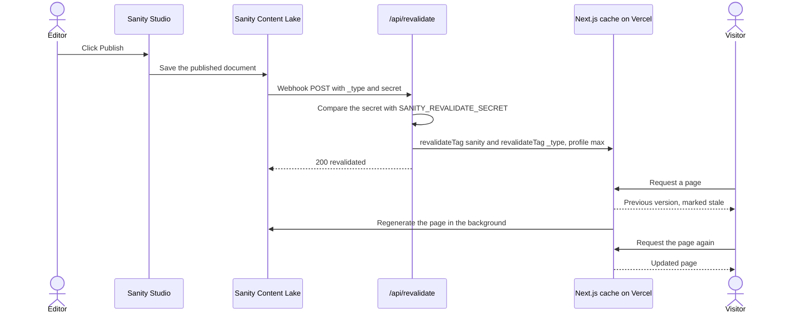
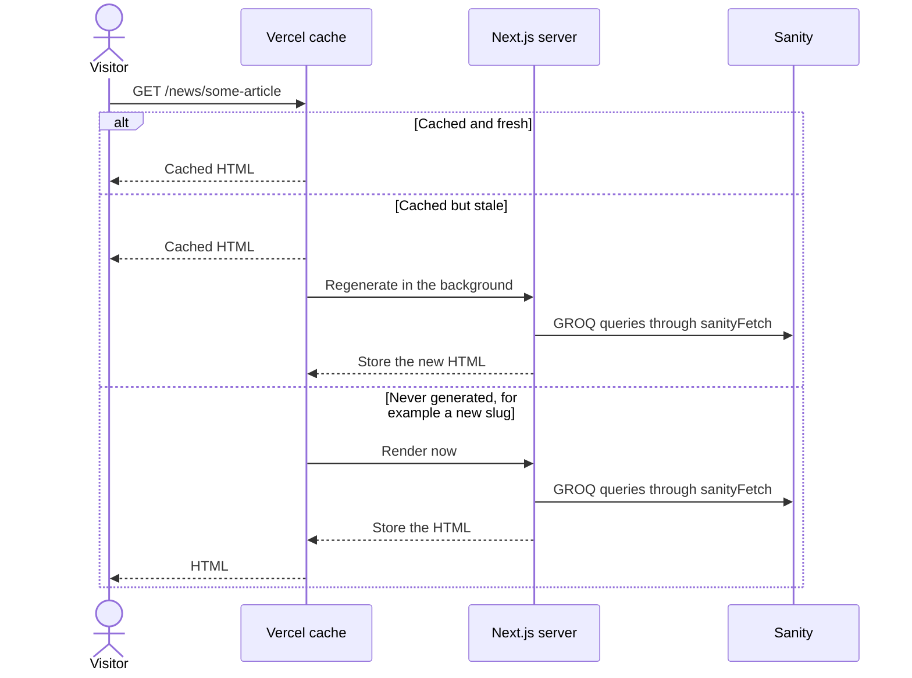

# Rendering and data flow

This page explains how pages are rendered and cached, how content from Sanity reaches visitors, and what happens when an editor publishes a change. It also covers draft mode, images, dates and error handling.

**Audience:** developers who change data fetching, add pages, or investigate why content is (not) updating.

## Layouts

The `app/` folder has two independent root layouts, implemented as [route groups](https://nextjs.org/docs/app/building-your-application/routing/route-groups):

| Layout | Applies to | What it provides |
|---|---|---|
| `app/(website)/layout.tsx` | All public pages | `<html>` and `<body>`, the Manrope font, default metadata, the PostHog provider, `Header`, `Footer`, `CookieBanner`, page view tracking, Vercel `<Analytics />`, and `<VisualEditing />` when draft mode is on |
| `app/studio/layout.tsx` | `/studio` | A full-height page for Sanity Studio, with `robots: noindex, nofollow` |

Because these are separate root layouts, moving between the website and `/studio` is a full page load.

## Rendering strategies

Every public page is rendered on the server. The table shows how each group of routes is rendered, as confirmed by a production build:

| Strategy | Routes | Behaviour |
|---|---|---|
| **Static** | `/about-us`, `/contact`, `/cookies`, `/privacy`, `/erasmus` and its subpages, `/for-students/*`, `/blog`, `/projects`, `/robots.txt` | Rendered once at build time. These pages do not read from Sanity, so content changes need a new deployment. |
| **Incremental static regeneration (ISR)** | `/`, `/news`, `/events`, `/upcoming-events`, `/national-board`, `/our-sections`, `/about-us/former-boards`, `/sitemap.xml`, `/rss.xml` | Rendered at build time and cached. Refreshed after 24 hours or, immediately, when the publish webhook expires the cache tags. `/upcoming-events` reads the `upcomingEvent` and `section` types. |
| **ISR with pre-rendered parameters** | `/news/[slug]`, `/events/[slug]` | `generateStaticParams` pre-renders every published slug at build time. A slug published later is rendered on its first request and then cached. Unknown slugs are checked against the cached list of all slugs (no Sanity request) and return a real `404`. |
| **Static shell, browser application** | `/studio/[[...tool]]` (`dynamic = 'force-static'`) | The page delivers the Studio application, which then runs in the browser. |
| **Dynamic** | `/api/*` | Executed on every request on the Node.js runtime. |

The cache lifetime and tags come from `sanityFetch`, described below. Pages do not export their own `revalidate` settings.

## Fetching data from Sanity

All server-side reads go through one function: `sanityFetch` in [`sanity/lib/fetch.ts`](../../esn-ukraine-web/sanity/lib/fetch.ts).

```ts
const news = await sanityFetch<NewsArticlePreview[]>({
  query: getLatestNewsQuery,   // GROQ query
  params: { /* GROQ parameters, e.g. slug */ },
  tags: ['news'],              // cache tags; use the document type
});
```

Its behaviour depends on the context:

| Context | Perspective | Caching | Other |
|---|---|---|---|
| **Normal request** (production, preview) | `published`: only published documents | Next.js data cache with `revalidate: 86400` (24 h) and the given tags | `stega` off |
| **Draft mode** | `drafts`: drafts override published documents | No caching (`revalidate: 0`) | Uses `SANITY_API_READ_TOKEN`; `stega` on, for visual editing |
| **Development** (`npm run dev`) | `published` | No caching (`revalidate: 0`) | Content changes appear on refresh |

Implementation details worth knowing:

- **The CDN is bypassed.** The client in `sanity/lib/client.ts` sets `useCdn: false`, so every fetch reads fresh data from the Sanity API. Next.js caching keeps the number of API calls low.
- **Tags are sanitised.** Characters outside `a–z`, `A–Z`, `0–9`, `_`, `-` and `:` are replaced with `-`. Tags such as `news:<slug>` can contain special characters from slugs, which caused server errors in the past.
- **Tags name every document type a query reads.** The webhook expires only the tags of the published type (and `type:slug` for one document), so publishing an event no longer regenerates every page of the site. There is no global tag any more.
- **`draftMode()` outside a request.** At build time, for example inside `generateStaticParams`, the function throws. `sanityFetch` catches the error and treats the request as not being in draft mode.

The queries themselves are listed in [Content model → Queries](../reference/content-model.md#queries).

## How published content reaches visitors

When an editor publishes a document, Sanity calls the website's revalidation webhook. The [API reference](../reference/api.md#post-apirevalidate) describes the endpoint.



Key points:

- `revalidateTag(tag, 'max')` uses **stale-while-revalidate**. The first request after publishing may still show the previous version; a refresh a few seconds later shows the new one.
- The route always invalidates the `sanity` tag. As a result, **any publish refreshes every CMS-backed page**, not only pages of the changed type. This is simple and cheap at the current content volume.
- If the webhook fails or is not configured, content still updates **within one hour** through time-based revalidation.
- **Static pages are not affected.** Content in code, such as the Erasmus+ pages, changes only with a new deployment.

The webhook itself is configured in Sanity, not in this repository. See [Deployment and environments](../guides/deployment-and-environments.md#configure-the-sanity-webhook).

## Serving a page



If a regeneration fails, for example because Sanity is unreachable or a component throws, Next.js keeps serving the last successfully generated version. A new deployment, however, fails if a page cannot be pre-rendered during the build.

## Draft mode and visual editing

Draft mode shows unpublished drafts on the real website and adds click-to-edit overlays that link back to the Studio.

1. A maintainer opens `/api/draft-mode/enable?secret=<SANITY_DRAFT_MODE_SECRET>&slug=/news/<slug>`.
2. The route compares the secret with `SANITY_DRAFT_MODE_SECRET` (constant-time comparison), enables Next.js draft mode (a cookie in the browser), and redirects to the given path. Only site-relative paths are accepted as `slug`.
3. While the cookie is present, `sanityFetch` uses the `drafts` perspective without caching. The root layout renders `<VisualEditing />`, which turns the invisible `stega` markers in strings into edit links.
4. `/api/draft-mode/disable?slug=/` turns draft mode off.

> [!WARNING]
> The enable URL contains a secret. Anyone with the URL can read draft content while the secret is valid. Do not share the URL or paste it into chats or issues. If it leaks, change `SANITY_DRAFT_MODE_SECRET` in Vercel (the Sanity read token itself never appears in a URL).

The Studio configuration (`sanity.config.ts`) does not include Sanity's Presentation tool, so the Studio has no **Preview** button.

## Images

| Source | Used for | How it is rendered |
|---|---|---|
| **Sanity assets** (`cdn.sanity.io`) | All images uploaded by editors | `SanityImage` (`components/ui/SanityImage.tsx`): `next/image` with a custom loader, so the **Sanity CDN** resizes the photo to the width the browser needs, at quality 75 in WebP/AVIF. These images never use the Vercel image optimizer and its Hobby quota |
| **`public/`** | Logos, the About Us history photos and video, the section map, the ESNcard photos, the "under construction" mascot | `next/image` (Vercel optimizer, AVIF or WebP) or ``/`<video>` |

Sanity image URLs are built in two ways:

- **The original upload URL** (`asset.url` from the shared `IMAGE_PROJECTION`, or `originalImageUrl()`) is used by cards, homepage slides, the "Our Network" collage, section logos, board photos, gallery photos and images in the article body. `SanityImage` asks the Sanity CDN for each width in the `srcset`.
- **`urlFor()`** from [`sanity/lib/image.ts`](../../esn-ukraine-web/sanity/lib/image.ts) builds a URL with a fixed width and height, honouring the editor's hotspot and crop. Article and event headers (16:9) and social sharing images (1200 × 630) use it.

The widths (`sizes`), the quality (75) and the sources match the production site before November 2026; only the server that resizes Sanity photos changed (Sanity CDN instead of Vercel), at the same visual quality.

Board photos, the gallery lightbox, the About Us history slider and the footer logo use a plain `` element, so these images are not resized by `next/image`.

Images in the article body and gallery use the low-quality image placeholder (`metadata.lqip`) from Sanity as a blur-up placeholder when it is available.

## Dates

`formatDate` in [`sanity/lib/utils.ts`](../../esn-ukraine-web/sanity/lib/utils.ts) formats dates as `14 Oct 2025` in Kyiv time (`Europe/Kyiv`), on the server and in the browser alike, so an event shortly after midnight Kyiv time shows the right day.

## Error handling

| Mechanism | File | When it is used |
|---|---|---|
| Error boundary | `app/(website)/error.tsx` | A rendering error inside a page. Shows "Something went wrong" with a **Try again** button. |
| Not found | `app/(website)/not-found.tsx` | `notFound()` calls, for example an unknown news or event slug. Shows a 404 page with a link home. |

### Built-in fallback content

Since November 2026 the website contains no sample events, placeholder people or stock photos. When Sanity returns nothing:

| Where | Condition | What visitors see |
|---|---|---|
| `/events`, `/news` | No documents | An empty-state message |
| `/national-board` | No board member documents | An empty-state message |
| Homepage "Our Network" | A slot has no photos | That slot stays empty; with no photos at all the collage is hidden |
| News and event cards | A document has no image | An "ESN" placeholder tile |
| Homepage hero | A Spotlight item has no image | The slide is skipped |

> [!IMPORTANT]
> The homepage hero has **no** fallback. It needs at least one published news item or event with **Spotlight** enabled. Without one, rendering the homepage fails. Regenerations keep serving the previous version, but the next deployment build fails.

If the website shows unfamiliar events or people, check first that Sanity is reachable and that the environment variables point to the right project and dataset.

## Related

- [Architecture overview](overview.md)
- [Content model](../reference/content-model.md)
- [API reference](../reference/api.md)
- [ADR-0001: Next.js App Router, static first](../adr/0001-nextjs-app-router-static-first.md)
- [ADR-0003: On-demand revalidation with cache tags](../adr/0003-on-demand-revalidation-with-cache-tags.md)
