# Add a content type

This guide walks through adding a new Sanity document type and showing it on the website, from the schema to the rendered page. The example adds **ESNcard partners** (`partner`) and lists them on `/for-students/esncard`.

**Audience:** developers. You should have the project running locally ([Getting started](../getting-started.md)). Paths are relative to `esn-ukraine-web/`.

## Overview

```mermaid
flowchart LR
    accTitle: Steps to add a content type
    accDescr: Define the schema, register it, add it to the Studio sidebar, write a query and a type, render it in a page with a cache tag, then make sure revalidation and documentation cover it.

    A["1. Schema"] --> B["2. Register"]
    B --> C["3. Studio sidebar"]
    C --> D["4. GROQ query"]
    D --> E["5. TypeScript type"]
    E --> F["6. Page"]
    F --> G["7. Revalidation"]
    G --> H["8. Sitemap and docs"]
```



Naming conventions used in this project:

- **Type and field names:** English, `camelCase`, singular, for example `boardMember` or `networkPhoto`.
- **Studio titles, descriptions and validation messages:** Ukrainian. Document type titles add the English name in parentheses, for example `Події (Events)`.

## 1. Define the schema

Create `sanity/schemaTypes/partner.ts`. Reuse the shared image formats and size validator:

```ts
import { defineField, defineType } from 'sanity'
import { ACCEPTED_IMAGE_TYPES, validateImageSize } from '../lib/imageValidation'

export default defineType({
  name: 'partner',
  title: 'Партнери ESNcard (Partners)',
  type: 'document',
  fields: [
    defineField({
      name: 'name',
      title: 'Назва партнера',
      type: 'string',
      validation: (rule) => rule.required(),
    }),
    defineField({
      name: 'logo',
      title: 'Логотип',
      type: 'image',
      options: { accept: ACCEPTED_IMAGE_TYPES },
      description: 'Макс. 2 МБ, формати JPG/PNG/WebP/AVIF.',
      validation: (rule) => rule.required().custom(validateImageSize(2, 3000, 3000)),
      fields: [
        defineField({
          name: 'alt',
          title: 'Alt текст',
          type: 'string',
          validation: (rule) => rule.required(),
        }),
      ],
    }),
    defineField({
      name: 'discount',
      title: 'Знижка або перевага',
      type: 'string',
      description: 'Наприклад: −10% на всі напої',
      validation: (rule) => rule.required().max(120),
    }),
    defineField({
      name: 'website',
      title: 'Вебсайт',
      type: 'url',
      validation: (rule) => rule.uri({ scheme: ['https'] }),
    }),
    defineField({
      name: 'order',
      title: 'Порядковий номер',
      type: 'number',
      initialValue: 10,
    }),
  ],
  preview: {
    select: { title: 'name', subtitle: 'discount', media: 'logo' },
  },
})
```

Guidelines:

- Validate everything editors can get wrong: required fields, lengths, URL schemes, image size.
- Add a `description` to fields whose purpose is not obvious. Editors read them.
- Provide an `alt` field for meaningful images.

## 2. Register the type

Add it to `sanity/schemaTypes/index.ts`:

```ts
import partner from './partner'

export const schema: { types: SchemaTypeDefinition[] } = {
  types: [news, event, section, newsCategory, eventCategory, boardMember, networkPhoto, formerBoard, partner],
}
```

## 3. Add it to the Studio sidebar

In `sanity/structure.ts`, add a list item at a sensible position:

```ts
S.listItem()
  .title('Партнери ESNcard (Partners)')
  .schemaType('partner')
  .child(
    S.documentTypeList('partner')
      .title('Партнери')
      .defaultOrdering([{ field: 'order', direction: 'asc' }])
  ),
```

Then add `'partner'` to the array in the `filter(...)` at the end of the file. Otherwise the type appears a second time at the bottom of the sidebar.

Run `npm run dev` and open <http://localhost:3000/studio>. The new type appears in the sidebar. Create and publish a test document.

## 4. Write the GROQ query

Add a query to `sanity/lib/queries.ts`. Project only the fields the page needs, and dereference image URLs with `->`:

```ts
export const getPartnersQuery = groq`
  *[_type == "partner"] | order(order asc, name asc) {
    _id,
    name,
    discount,
    website,
    "logoUrl": logo.asset->url,
    "logoAlt": logo.alt
  }
`;
```

To experiment with queries, use the Vision tool in the Studio. It is available in development.

## 5. Add a TypeScript type

Add the result type to `sanity/lib/types.ts`:

```ts
export interface Partner {
  _id: string;
  name: string;
  discount: string;
  website?: string;
  logoUrl: string | null;
  logoAlt?: string;
}
```

## 6. Fetch and render the data

Fetch in a Server Component with `sanityFetch`, and pass the **type name as the cache tag**:

```tsx
import Image from 'next/image';
import { sanityFetch } from '@/sanity/lib/fetch';
import { getPartnersQuery } from '@/sanity/lib/queries';
import type { Partner } from '@/sanity/lib/types';

export default async function ESNcardPage() {
  const partners = await sanityFetch<Partner[]>({ query: getPartnersQuery, tags: ['partner'] });

  return (
    <main className="min-h-svh bg-white">
      {/* … existing content … */}
      {partners.length === 0 ? (
        <p className="text-gray-500 text-center py-12">Partner offers will be announced soon.</p>
      ) : (
        <ul className="grid gap-6 sm:grid-cols-2 lg:grid-cols-3">
          {partners.map((partner) => (
            <li key={partner._id} className="rounded-2xl border border-gray-100 p-6 shadow-sm">
              {partner.logoUrl && (
                <Image src={partner.logoUrl} alt={partner.logoAlt ?? partner.name} width={160} height={80} className="h-16 w-auto object-contain" />
              )}
              <h3 className="mt-4 text-lg font-bold text-esn-dark">{partner.name}</h3>
              <p className="text-gray-600">{partner.discount}</p>
            </li>
          ))}
        </ul>
      )}
    </main>
  );
}
```

Notes:

- Because `sanityFetch` caches for an hour with tags, the page turns from **static** into **ISR** automatically. No `revalidate` export is needed.
- `cdn.sanity.io` is already an allowed image host.
- Render an explicit empty state rather than built-in sample data, so that missing content or a broken connection is visible.

## 7. Make sure revalidation covers the type

The revalidation webhook calls `revalidateTag(_type)` and `revalidateTag('sanity')`, so the page refreshes after a publish without further work.

If the webhook in Sanity uses a **filter** that lists document types, add `partner` to it. See [Configure the Sanity webhook](deployment-and-environments.md#configure-the-sanity-webhook).

## 8. Sitemap, documentation and release

- If the type gets its own detail pages, for example `/partners/[slug]`, add them to `app/sitemap.ts`. Extend the GROQ filter there and build the URL per type. Also add `generateStaticParams` and `generateMetadata` like the news pages do.
- Document the type in [Content model](../reference/content-model.md) and, for editors, in the [content editing guide](../content-editing/README.md).
- Update [Routes](../reference/routes.md) if a page changed its rendering or data source.
- Open a pull request. After the merge, the Studio in production shows the new type, and editors can start adding content.

## Changing or removing a type later

- Renaming or removing fields does **not** change existing documents. Migrate the data with [`sanity migration`](https://www.sanity.io/docs/content-migration-cheat-sheet), or make queries tolerant with `coalesce()`.
- Before you remove a type, unpublish or delete its documents, and remove its queries and pages.

## Related

- [Content model](../reference/content-model.md)
- [Rendering and data flow](../architecture/rendering-and-data-flow.md#fetching-data-from-sanity)
- [Common tasks](common-tasks.md)
