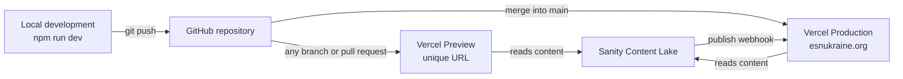

# Deployment and environments

How the website is built and deployed, how to roll back, and how to configure the services the deployment depends on: Vercel, the Sanity webhook, CORS and secrets.

**Audience:** maintainers and developers with access to Vercel or Sanity.

> [!NOTE]
> Vercel and Sanity settings are not stored in this repository. Facts that could not be verified from the code are marked **To confirm**. Fill them in when you have dashboard access.

## Environments

| Environment | Where | Built from | Typical use |
|---|---|---|---|
| **Development** | Your computer, `npm run dev` | Your working copy | Building and testing changes. Sanity data is not cached |
| **Preview** | Vercel, a unique URL per deployment | Every pushed branch and pull request | Reviewing changes before merging. `VERCEL_ENV=preview` |
| **Production** | Vercel, <https://esnukraine.org> | The `main` branch | The live website. `VERCEL_ENV=production` |

GitHub's deployment records confirm this mapping: production deployments are created for the merge commits on `main` (for example pull requests #45–#47), and preview deployments for commits on feature branches.

## Vercel project settings

| Setting | Value | Status |
|---|---|---|
| Framework preset | Next.js | Inferred |
| Root directory | `esn-ukraine-web` | Inferred. The repository root has no `package.json`, so Vercel must build the subfolder |
| Production branch | `main` | Verified through the deployment records |
| Build command | `next build` (default) | To confirm |
| Install command | Default; npm with `package-lock.json` | To confirm |
| Node.js version | Must be 20.19+ or 22.12+ (Sanity's requirement) | To confirm |
| Domains | `esnukraine.org` | To confirm, including `www` and redirects between them |
| Environment variables | See [Environment variables](../reference/environment-variables.md#environment-matrix) | To confirm |

> [!TIP]
> Commits that change only documentation also trigger a deployment. If that becomes a problem, configure the **Ignored Build Step** setting in Vercel (project → **Settings** → **Git**) so that it skips builds without changes in `esn-ukraine-web/`.

## Releasing a change

1. Open a pull request. Wait for the Vercel Preview deployment, then check it ([CONTRIBUTING.md](../../CONTRIBUTING.md#4-check-the-preview-deployment)).
2. Merge into `main`. Vercel starts a production build automatically. The build pre-renders all news and event pages and needs Sanity to be reachable.
3. When the deployment is **Ready**, run a short smoke test on <https://esnukraine.org>:
   - the homepage loads, and the hero slider shows the Spotlight items;
   - a news article and an event page open;
   - `/studio` loads;
   - `/sitemap.xml` lists the pages;
   - the browser console shows no errors.
4. Check **Logs** in Vercel for runtime errors over the next hours.

If the production build fails, the previous deployment stays live. Fix the problem in a new pull request.

## Rolling back

**Code.** Use Vercel's [Instant Rollback](https://vercel.com/docs/instant-rollback):

1. In the Vercel dashboard, open the project → **Deployments**.
2. Find the last good production deployment.
3. Open its menu (**…**) and choose **Instant Rollback**.

Then fix forward. Revert the faulty change in Git with `git revert -m 1 <merge-commit>` in a new pull request, so that the next merge into `main` does not bring the problem back.

**Content.** Rolling back a deployment does not change content in Sanity. To restore a document, open it in the Studio and use its history to go back to an earlier version. For larger problems, restore from a dataset export (see [Recurring maintenance tasks](maintenance-tasks.md#back-up-the-sanity-dataset)).

## Managing environment variables

- Edit them in Vercel → the project → **Settings** → **Environment Variables**. Choose the environments (Production, Preview, Development) each value applies to.
- Changes take effect only for **new** deployments. Redeploy after changing a value. This is mandatory for `NEXT_PUBLIC_` variables, which are inlined at build time.
- To copy the Development values to your computer, run `vercel env pull .env.local` in `esn-ukraine-web/`, after `vercel link`.
- Keep [`.env.example`](../../esn-ukraine-web/.env.example) and the [reference page](../reference/environment-variables.md) up to date.

## Configure the Sanity webhook

The webhook tells the website that content changed (see [Rendering and data flow](../architecture/rendering-and-data-flow.md#how-published-content-reaches-visitors)). Create or check it in [sanity.io/manage](https://www.sanity.io/manage) → the project → **API** → **Webhooks**:

| Setting | Recommended value |
|---|---|
| Name | `Revalidate esnukraine.org` |
| URL | `https://esnukraine.org/api/revalidate` |
| Dataset | The production dataset |
| Trigger on | Create, Update, Delete |
| Filter | Optional, for example `_type in ["news", "event", "section", "boardMember", "formerBoard", "networkPhoto", "newsCategory", "eventCategory"]` |
| Projection | `{ _type }`. The route uses `_type` as an extra cache tag |
| HTTP method | `POST` |
| HTTP headers | `x-sanity-secret: <value of SANITY_REVALIDATE_SECRET>` |
| Drafts | Off: trigger only for published documents |

Notes:

- The route also accepts `Authorization: Bearer <secret>` or `?secret=<secret>`. Prefer a header, because URLs appear in logs.
- Sanity's own **Secret** field signs the payload. The route does not verify the signature, so the header above is required.
- If you add a filter, extend it whenever you add a content type.
- **To test:** publish a small change and check the webhook's delivery log in Sanity. It should show `200`. A `401` means the secret does not match.

> [!NOTE]
> **To confirm:** the current webhook configuration (URL, filter, header).

## Configure CORS origins for the Studio

The embedded Studio calls the Sanity API from the browser. Every origin that serves the Studio must be allowed in sanity.io/manage → the project → **API** → **CORS origins**, with **Allow credentials** enabled:

- `https://esnukraine.org`
- `http://localhost:3000` (local development)
- Preview URLs, if editors or developers use the Studio on previews. Sanity supports wildcards, for example a pattern that matches the project's Vercel preview domain.

> [!NOTE]
> **To confirm:** the current list of CORS origins.

## Rotate secrets

Rotate secrets when a maintainer with access leaves the team, after a suspected leak, and periodically (for example once a year). Always add the new value first, deploy, verify, and only then revoke the old one.

| Secret | Steps |
|---|---|
| `SANITY_REVALIDATE_SECRET` | 1. Generate a new value (`openssl rand -base64 32`). 2. Set it in Vercel (Production) and redeploy. 3. Update the header in the Sanity webhook. 4. Publish a test change and check for `200` in the webhook log. |
| `SANITY_API_READ_TOKEN` | 1. In sanity.io/manage → **API** → **Tokens**, add a token with the Viewer role. 2. Set it in Vercel and redeploy. 3. Test draft mode. 4. Delete the old token. |
| `RESEND_API_KEY` | 1. In Resend → **API Keys**, create a key that can manage contacts. 2. Set it in Vercel and redeploy. 3. Test a subscription. 4. Delete the old key. |
| `KV_REST_API_URL`, `KV_REST_API_TOKEN` | Reset the token in the Upstash console (or through the Vercel integration), update Vercel and redeploy. |
| `NEXT_PUBLIC_POSTHOG_KEY` | This key is public by design. Change it only when you switch to another PostHog project. |

Never send secrets through chat or email. Share them through a password manager.

## Monitoring

| What | Where |
|---|---|
| Build status and build logs | Vercel → **Deployments** |
| Runtime errors and API logs | Vercel → **Logs** (the newsletter route logs with the prefix `[Newsletter]`) |
| Traffic | Vercel → **Analytics** (Web Analytics), PostHog dashboards |
| Webhook deliveries | sanity.io/manage → **API** → **Webhooks** → the webhook's log |
| Sanity usage (API requests, bandwidth, documents, assets) | sanity.io/manage → the project → **Usage** |

No dedicated error tracking service is configured. Errors appear only in the Vercel logs, and Vercel keeps them for a limited time.

## Plans and costs

> [!NOTE]
> **To confirm:** the plan of each service (Vercel, Sanity, Resend, Upstash, PostHog), who pays for it, and when it renews. Record the answers in [Services and accounts](../operations/services-and-accounts.md). Check that each plan's terms allow use by a non-profit organisation.

## Related

- [Environment variables](../reference/environment-variables.md)
- [Services and accounts](../operations/services-and-accounts.md)
- [Troubleshooting](troubleshooting.md)
