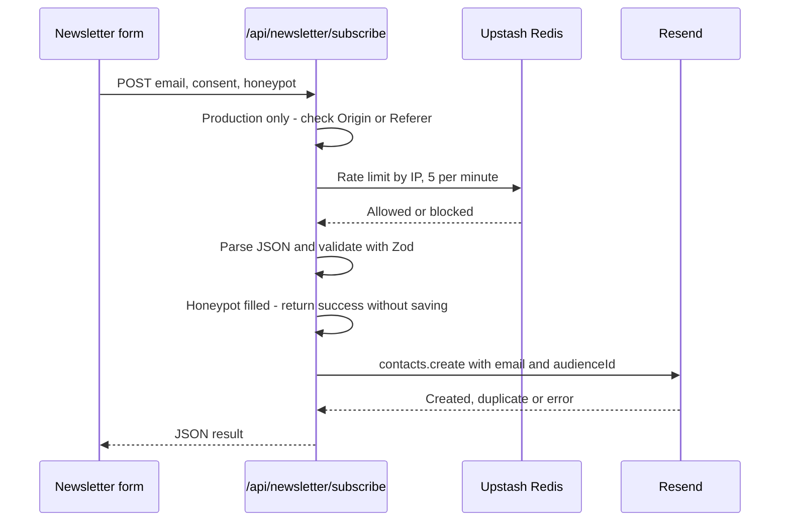

# API reference

The website has four API routes under `esn-ukraine-web/app/api/`. They are used by Sanity (revalidation webhook), by maintainers (draft mode) and by the newsletter form.

**Audience:** developers who change these routes, and maintainers who configure the Sanity webhook or debug the newsletter.

| Method and path | Purpose | Authentication |
|---|---|---|
| [`POST /api/revalidate`](#post-apirevalidate) | Invalidate cached content after a publish in Sanity | Shared secret |
| [`GET /api/draft-mode/enable`](#get-apidraft-modeenable) | Turn on draft mode in the browser | Sanity read token |
| [`GET /api/draft-mode/disable`](#get-apidraft-modedisable) | Turn off draft mode | None |
| [`POST /api/newsletter/subscribe`](#post-apinewslettersubscribe) | Subscribe an email address to the newsletter | Origin check and rate limit |

All JSON responses use `Content-Type: application/json`.

## POST /api/revalidate

Invalidates the Next.js data cache, so that pages show newly published content. It is called by a [Sanity GROQ-powered webhook](https://www.sanity.io/docs/webhooks) on every publish.

- **Source:** [`app/api/revalidate/route.ts`](../../esn-ukraine-web/app/api/revalidate/route.ts)
- **Runtime:** Node.js
- **Environment:** `SANITY_REVALIDATE_SECRET`

### Authentication

The route reads a secret from the request and compares it with `SANITY_REVALIDATE_SECRET`. It checks these places in order:

1. the `Authorization` header, with an optional `Bearer ` prefix;
2. the `x-sanity-secret` header;
3. the `secret` query parameter.

Prefer a header: query parameters end up in access logs. The route does **not** verify Sanity's `sanity-webhook-signature` header, so the webhook must send the secret in one of the places above.

### Request body

Optional JSON. Only one field is read:

| Field | Type | Description |
|---|---|---|
| `_type` | string | The document type that changed, for example `news`. It is used as an additional cache tag. |

### Behaviour

1. Always calls `revalidateTag('sanity', 'max')`. Every Sanity query is tagged `sanity`, so this refreshes all CMS-backed pages.
2. If `_type` is a string, also calls `revalidateTag(_type, 'max')`.

With the `max` profile, cached entries are marked stale and refreshed in the background on the next request (stale-while-revalidate).

### Responses

| Status | Body | When |
|---|---|---|
| `200` | `{ "revalidated": true, "now": 1761400000000 }` | Success. `now` is a timestamp in milliseconds |
| `401` | `{ "message": "Unauthorized: Invalid token" }` | The secret is missing or wrong |
| `500` | `{ "message": "Internal Server Error" }` | Unexpected error. The message is logged |

### Example

```bash
curl -X POST "https://esnukraine.org/api/revalidate" \
  -H "x-sanity-secret: <SANITY_REVALIDATE_SECRET>" \
  -H "Content-Type: application/json" \
  -d '{"_type":"news"}'
```

See [Deployment and environments](../guides/deployment-and-environments.md#configure-the-sanity-webhook) for the webhook configuration in Sanity.

## GET /api/draft-mode/enable

Turns on [Next.js draft mode](https://nextjs.org/docs/app/guides/draft-mode) in the current browser and redirects to a page. In draft mode, pages show unpublished drafts and visual editing overlays. See [Rendering and data flow](../architecture/rendering-and-data-flow.md#draft-mode-and-visual-editing).

- **Source:** [`app/api/draft-mode/enable/route.ts`](../../esn-ukraine-web/app/api/draft-mode/enable/route.ts)
- **Environment:** `SANITY_API_READ_TOKEN`

### Query parameters

| Parameter | Required | Description |
|---|---|---|
| `token` | Yes | Must equal `SANITY_API_READ_TOKEN` |
| `slug` | No | The path to open after enabling draft mode, for example `/news/my-article`. Defaults to `/`. Use a path on this website. |

### Responses

| Status | Body | When |
|---|---|---|
| `307` | Redirect to `slug` and set the draft mode cookie | The token is valid |
| `401` | Plain text `Invalid token` | The token is missing or wrong |

> [!WARNING]
> The URL contains a secret token. Do not share it, and do not paste it into chats, issues or documents.

## GET /api/draft-mode/disable

Turns off draft mode in the current browser and redirects to a page.

- **Source:** [`app/api/draft-mode/disable/route.ts`](../../esn-ukraine-web/app/api/draft-mode/disable/route.ts)

| Parameter | Required | Description |
|---|---|---|
| `slug` | No | The path to open afterwards. Defaults to `/`. Use a path on this website. |

**Response:** `307` redirect to `slug`, with the draft mode cookie removed.

## POST /api/newsletter/subscribe

Adds an email address to the newsletter audience in Resend. It is called by the newsletter form ([`components/sections/NewsletterForm.client.tsx`](../../esn-ukraine-web/components/sections/NewsletterForm.client.tsx)) on the homepage and the News page.

- **Source:** [`app/api/newsletter/subscribe/route.ts`](../../esn-ukraine-web/app/api/newsletter/subscribe/route.ts)
- **Runtime:** Edge
- **Environment:** `RESEND_API_KEY`, `RESEND_AUDIENCE_ID`, `KV_REST_API_URL`, `KV_REST_API_TOKEN`

### Request

```http
POST /api/newsletter/subscribe
Content-Type: application/json

{ "email": "student@example.com", "consent": true, "honeypot": "" }
```

| Field | Type | Rules |
|---|---|---|
| `email` | string | Required. Trimmed, at most 254 characters, a valid email address. Lowercased before saving. |
| `consent` | boolean | Required. Must be `true` (privacy policy consent). |
| `honeypot` | string | Optional. Comes from a hidden field that people do not see. A non-empty value marks the request as a bot. |

### Processing steps

"Production" below means `NODE_ENV=production` and `VERCEL_ENV` is not `preview`. Local `npm run dev` and Vercel Preview deployments therefore skip the origin check and do not require the rate limiter. A local `npm run start` counts as production.



1. **Origin check (production only).** The `Origin` or `Referer` header must have the host `esnukraine.org` or a subdomain of it. Otherwise the route returns `403`.
2. **Client IP.** Determined with `ipAddress()` from `@vercel/functions`.
3. **Rate limit.** If Upstash is configured: a sliding window of 5 requests per minute per IP address. If Upstash is not configured in production, the route returns `503`. Elsewhere the limit is skipped.
4. **Parsing and validation** with Zod. See the field rules above.
5. **Honeypot.** If filled in, the route returns a fake success response and stores nothing.
6. **Resend configuration.** If `RESEND_API_KEY` or `RESEND_AUDIENCE_ID` is missing, the route returns `503`.
7. **Subscription.** `resend.contacts.create({ email, unsubscribed: false, audienceId })`. A duplicate address is treated as success. The route recognises duplicates by a `validation_error` or an "already exists" message.

### Responses

| Status | `error` or `message` | When |
|---|---|---|
| `200` | "Welcome aboard! You've been subscribed to our newsletter." (+ `contactId`) | Subscribed |
| `200` | "Welcome aboard! You've been subscribed to our newsletter." | Already subscribed |
| `200` | "Subscribed successfully!" | Honeypot filled in; nothing stored |
| `400` | "Invalid request body." | The body is not valid JSON |
| `400` | The first validation message, for example "Please enter a valid email address." or "Privacy consent is required." | Validation failed |
| `403` | "Unauthorized origin." | Production request from another origin |
| `429` | "Too many requests. Please try again later." (+ `Retry-After` header, in seconds) | Rate limit exceeded |
| `503` | "Service Unavailable" | Production without Upstash credentials |
| `503` | "Newsletter service is temporarily unavailable." | Resend credentials missing |
| `500` | "Something went wrong. Please try again later." | Resend returned an error |
| `500` | "An unexpected error occurred. Please try again." | Any other error |

All responses have the shape `{ "success": boolean, "message"?: string, "error"?: string }`.

### Logging

Logs never contain email addresses. The route logs blocked origins, missing configuration, Resend errors and unexpected exceptions with the prefix `[Newsletter]`. Logs are visible in the Vercel dashboard (**Logs**).

## Related

- [Environment variables](environment-variables.md)
- [Privacy and analytics](../architecture/privacy-and-analytics.md)
- [Troubleshooting](../guides/troubleshooting.md)
