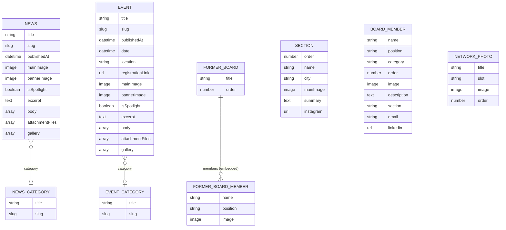

# Content model

This page is the reference for the Sanity content model: the document types, their fields and validation rules, how they relate to each other, where they appear on the website, and which GROQ queries read them.

**Audience:** developers who change schemas or queries. Editors find task-oriented instructions in the [content editing guide](../content-editing/README.md).

The schemas live in [`esn-ukraine-web/sanity/schemaTypes/`](../../esn-ukraine-web/sanity/schemaTypes/) and are registered in `index.ts`. Studio labels, descriptions and validation messages are in Ukrainian; this page quotes the labels so that you can match them with the Studio.

## Overview

| Type | Studio label | Purpose | Shown on |
|---|---|---|---|
| [`news`](#news) | Новини | News articles | `/`, `/news`, `/news/[slug]`, homepage hero |
| [`event`](#event) | Події (Events) | Events | `/`, `/events`, `/events/[slug]`, homepage hero |
| [`newsCategory`](#newscategory-and-eventcategory) | Категорії новин | Categories for news | Badge on `/news` cards |
| [`eventCategory`](#newscategory-and-eventcategory) | Категорії подій | Categories for events | Not displayed at the moment |
| [`section`](#section) | Секції (ESN Sections) | Local ESN sections | `/our-sections` |
| [`boardMember`](#boardmember) | Члени борду (National Board) | Current National Board and related bodies | `/national-board` |
| [`formerBoard`](#formerboard) | Колишні борди (Former Boards) | Past boards with their members | `/about-us/former-boards` |
| [`networkPhoto`](#networkphoto) | Фотографії "Our Network" (Головна) | Photos for the homepage collage | `/` |

The only references between documents are the optional categories on news and events. Sections, board members and events are not linked to each other.

## Studio structure

The sidebar is defined in [`sanity/structure.ts`](../../esn-ukraine-web/sanity/structure.ts):

| Sidebar item | Type | Default order |
|---|---|---|
| Новини (News) | `news` | `publishedAt`, newest first |
| Події (Events) | `event` | `date`, latest first |
| Секції ESN (Sections) | `section` | `order`, then `name` |
| Члени Борду (Board Members) | `boardMember` | `order`, then `name` |
| Категорії новин | `newsCategory` | — |
| Категорії подій | `eventCategory` | — |
| Фото "Our Network" (Головна) | `networkPhoto` | `slot`, then `order` |
| Колишні борди (Former Boards) | `formerBoard` | Added automatically at the end, because it is not listed explicitly in `structure.ts` |

The Vision tool (a GROQ playground) is available in the Studio only in development (`npm run dev`).

## news

File: `sanity/schemaTypes/news.ts`. Studio label: **Новини**.

| Field | Studio label | Type | Required | Rules and notes |
|---|---|---|---|---|
| `title` | Заголовок новини | string | Yes | 5–150 characters |
| `slug` | Посилання (Slug) | slug | Yes | Generated from the title, max 96 characters. URL: `/news/<slug>` |
| `publishedAt` | Дата та час публікації | datetime | Yes | Defaults to now. Determines the sort order and the displayed date |
| `category` | Категорія | reference → `newsCategory` | No | Shown as a badge on `/news` cards |
| `mainImage` | Прев'ю зображення (для карточки) | image | Yes | ≤ 12 MB, ≤ 10,000 × 10,000 px. Card image, header image on the detail page, social sharing image |
| `isSpotlight` | Показувати в Spotlight на головній | boolean | No | Default `false`. Adds the article to the homepage hero |
| `bannerImage` | Банер (задній фон) | image | No | ≤ 12 MB. Faint background of the detail page header and background of the homepage hero slide. The detail page falls back to `mainImage` |
| `excerpt` | Короткий опис (Summary) | text | Yes | 10–300 characters. Card text, detail page intro, meta description |
| `body` | Текст статті | array (rich text) | No | See [Rich text](#rich-text-body) |
| `attachmentFiles` | Прикріплені файли (Attachment Files) | array of files | No | See [Attachments](#attachments-and-gallery) |
| `gallery` | Photo Gallery | array of images | No | See [Gallery](#attachments-and-gallery) |

## event

File: `sanity/schemaTypes/event.ts`. Studio label: **Події (Events)**. The shared fields work as in `news`:

| Field | Studio label | Type | Required | Rules and notes |
|---|---|---|---|---|
| `title` | Назва події | string | Yes | 5–150 characters |
| `slug` | Посилання (Slug) | slug | Yes | Max 96 characters. URL: `/events/<slug>` |
| `publishedAt` | Дата та час створення | datetime | Yes | Defaults to now. Used as the Open Graph publication time |
| `excerpt` | Короткий опис (Summary) | text | Yes | 10–300 characters. On `/events` cards, it is shortened to three sentences |
| `category` | Категорія | reference → `eventCategory` | No | Not displayed at the moment |
| `date` | Дата проведення | datetime | Yes | Event date. Determines the sort order on `/events` and the homepage |
| `location` | Місце проведення | string | No | Shown on `/events` cards and on the detail page |
| `registrationLink` | Посилання на реєстрацію (Google Form) | url | No | When set, the detail page shows a registration box. The box text says registration is open, regardless of the event date |
| `mainImage` | Прев'ю зображення (для карточки) | image | Yes | ≤ 12 MB, ≤ 10,000 × 10,000 px |
| `isSpotlight` | Показувати в Spotlight на головній | boolean | No | Default `false` |
| `bannerImage` | Банер (задній фон) | image | No | ≤ 12 MB |
| `body` | Текст сторінки події | array (rich text) | No | Same as news |
| `attachmentFiles` | Прикріплені файли (Attachment Files) | array of files | No | Same as news |
| `gallery` | Photo Gallery | array of images | No | Same as news |

## Rich text (`body`)

News and events share the same [Portable Text](https://www.sanity.io/docs/presenting-block-text) configuration. It is defined separately in `news.ts` and `event.ts`, so change both together.

| Element | Options |
|---|---|
| Block styles | Звичайний (`normal`), Великий вступ (`lead`), Малий текст (`small`), Заголовок H2/H3/H4 (`h2`, `h3`, `h4`), Цитата (`blockquote`) |
| Lists | Bulleted and numbered (Sanity defaults) |
| Decorators | Bold, italic, underline, strike-through, inline code |
| Annotation `link` | URL with the scheme `http`, `https` or `mailto`, or a relative path. External links open in a new tab |
| Annotation `textColor` | A fixed palette: ESN cyan, magenta, dark blue, green, orange, black, white, grey, red |
| Annotation `textSize` | 12–72 px |
| Block `divider` | Розділювач (Лінія): a solid or dashed line |
| Block `image` | Фото у тексті: ≤ 2 MB, with caption, alt text, width (25–100 %), alignment (left/centre/right; left and right let the text wrap around the image) and rounded corners |
| Block `imageGallery` | Кілька фото в ряд: 2–6 images (≤ 2 MB each, with caption and alt text), 2–4 columns, rounded corners, gap from none to large |

The website renders rich text with `PortableTextComponents` objects, which are also defined separately in `app/(website)/news/[slug]/page.tsx` and `app/(website)/events/[slug]/page.tsx`. When you add a block type, update both schemas and both renderers. See [Common tasks](../guides/common-tasks.md#add-a-rich-text-block-type).

## Attachments and gallery

| Field | Item type | Rules | Rendering |
|---|---|---|---|
| `attachmentFiles` | `file` with `title` and `description` | `.pdf`, `.doc`, `.docx`, `.xls`, `.xlsx`, `.ppt`, `.pptx`, ≤ 10 MB each | `AttachmentFiles` component below the text. On desktop, PDFs open in an in-page preview; on mobile, files open in the browser |
| `gallery` | `image` with `caption` | ≤ 2 MB each | `PhotoGalleryLightbox` below the attachments: a grid of photos with a full-screen viewer |

## newsCategory and eventCategory

Files: `newsCategory.ts`, `eventCategory.ts`. Studio labels: **Категорії новин**, **Категорії подій**.

| Field | Studio label | Type | Required | Rules |
|---|---|---|---|---|
| `title` | Назва категорії | string | Yes | 2–50 characters |
| `slug` | Slug | slug | Yes | Generated from the title, max 50 characters |

Only the title of a news category is displayed (on `/news` cards). There are no category pages or filters.

## section

File: `section.ts`. Studio label: **Секції (ESN Sections)**.

| Field | Studio label | Type | Required | Rules and notes |
|---|---|---|---|---|
| `order` | Порядковий номер (Order) | number | No | Default 10. Lower numbers come first |
| `name` | Назва секції | string | Yes | For example "ESN Kyiv" |
| `city` | Місто секції | string | Yes | Also used, in lower case, as the HTML `id` of the card, for example `/our-sections#kyiv` |
| `mainImage` | Логотип секції | image | Yes | ≤ 2 MB, ≤ 3,000 × 3,000 px |
| `summary` | Короткий опис (для карточки) | text | Yes | 10–300 characters |
| `instagram` | Instagram сторінка (обов'язково) | url | Yes | `http` or `https`. The card's **Instagram** button links here |

Sections have no detail pages. The map on `/our-sections` is a static image and does not use this data.

## boardMember

File: `boardMember.ts`. Studio label: **Члени борду (National Board)**.

| Field | Studio label | Type | Required | Rules and notes |
|---|---|---|---|---|
| `name` | Ім'я та прізвище (або назва) | string | Yes | |
| `position` | Посада / Позиція | string | Yes | |
| `category` | Категорія / Розділ борду | string (list) | Yes | `board` = "The Board 2025-26", `support` = "The Board Support 2025-26", `audit` = "The Audit Board & Advisory Council". Default `board` |
| `order` | Порядковий номер | number | No | Default 10. Order within the group |
| `image` | Фотографія (продовгувата / вертикальна 4:5) | image with `alt` | Yes | ≤ 2 MB, ≤ 3,000 × 3,500 px. The `alt` field is required |
| `description` | Опис (відкривається при натисканні на фото) | text | No | Not displayed at the moment |
| `section` | Секція ESN | string | No | Free text, for example "ESN Kyiv". Not displayed |
| `email` | Email | string | No | Not displayed |
| `linkedin` | LinkedIn URL | url | No | Not displayed |

`/national-board` groups members by `category`. Members without a category appear in the Board group. The group headings, including the year, are defined in code in `components/sections/BoardSection.client.tsx`; the list labels are in `boardMember.ts`.

> [!IMPORTANT]
> The page query fetches `description`, `section`, `email` and `linkedin` and passes them to the browser, even though they are not displayed. Treat every field as public.

## formerBoard

File: `formerBoard.ts`. Studio label: **Колишні борди (Former Boards)**.

| Field | Studio label | Type | Required | Rules and notes |
|---|---|---|---|---|
| `title` | Назва (наприклад: Board 2021/22) | string | Yes | Heading of the accordion item |
| `order` | Порядковий номер | number | Yes | Default 2020. **Higher numbers come first**; use the start year |
| `members` | Члени борду | array of objects | No | Each member has `name` (required), `position` (required) and `image` (required, ≤ 2.5 MB, ≤ 3,000 × 3,500 px, optional `alt`) |

## networkPhoto

File: `networkPhoto.ts`. Studio label: **Фотографії "Our Network" (Головна)**.

| Field | Studio label | Type | Required | Rules and notes |
|---|---|---|---|---|
| `title` | Назва / Опис фотографії (Alt текст) | string | Yes | Used as the image's alt text |
| `slot` | В якому слоті на головній сторінці відображати? | string (radio) | Yes | `slotA` (top left, landscape), `slotB` (bottom left, landscape), `slotC` (right, tall). Default `slotA` |
| `image` | Фотографія | image | Yes | ≤ 2 MB, ≤ 3,500 × 3,500 px |
| `order` | Порядок відображення (необов'язково) | number | No | Default 10. Order within the slot |

Each slot rotates through its photos: slot A every 4.5 s, slot B every 6 s, slot C every 5.2 s. A slot without photos shows built-in stock photos.

## Upload limits

Validators from [`sanity/lib/imageValidation.ts`](../../esn-ukraine-web/sanity/lib/imageValidation.ts) enforce these limits:

| Field | Max file size | Max resolution | Formats |
|---|---|---|---|
| News/event `mainImage`, `bannerImage` | 12 MB | 10,000 × 10,000 px | JPEG, PNG, WebP, AVIF |
| Rich text images, photo rows, `gallery` | 2 MB | 10,000 × 10,000 px | JPEG, PNG, WebP, AVIF |
| `attachmentFiles` | 10 MB | — | PDF, DOC, DOCX, XLS, XLSX, PPT, PPTX |
| Section logo | 2 MB | 3,000 × 3,000 px | JPEG, PNG, WebP, AVIF |
| Board member photo | 2 MB | 3,000 × 3,500 px | JPEG, PNG, WebP, AVIF |
| Former board member photo | 2.5 MB | 3,000 × 3,500 px | JPEG, PNG, WebP, AVIF |
| Network photo | 2 MB | 3,500 × 3,500 px | JPEG, PNG, WebP, AVIF |

How the validation works:

- The resolution is read from the asset ID, for example `image-<hash>-4000x3000-jpg`. The file size is read with a query for the asset document.
- If that query fails, for example because of a network problem, the validator does not block saving.
- Some field descriptions in the Studio mention other numbers. The attachments description, for example, mentions 5 MB. The validators above are what is enforced.

## Queries

GROQ queries are either shared in [`sanity/lib/queries.ts`](../../esn-ukraine-web/sanity/lib/queries.ts) or defined inline in the page that uses them. Every query is executed with [`sanityFetch`](../architecture/rendering-and-data-flow.md#fetching-data-from-sanity), and every tag list automatically includes `sanity`.

| Query | Defined in | Returns | Used by | Cache tags |
|---|---|---|---|---|
| `getSpotlightItemsQuery` | `queries.ts` | Up to 5 news items and events with `isSpotlight == true`, newest first (by `date`, otherwise `publishedAt`) | Homepage hero | `news`, `event` |
| `getLatestNewsQuery` | `queries.ts` | The 3 newest news items | Homepage | `news` |
| `getLatestEventsQuery` | `queries.ts` | The 4 events with the latest `date` | Homepage "Moments We Shared" | `event` |
| `getNetworkPhotosQuery` | `queries.ts` | All network photos with an image, by slot and order | Homepage collage | `networkPhoto` |
| `getAllNewsSlugsQuery` | `queries.ts` | All news slugs | `generateStaticParams` of `/news/[slug]` | `news` |
| `getNewsBySlugQuery` | `queries.ts` | One news item with body, attachments and gallery | `/news/[slug]` and its metadata | `news`, `news:<slug>` |
| `getAllEventsSlugsQuery` | `queries.ts` | All event slugs | `generateStaticParams` of `/events/[slug]` | `event` |
| `EVENT_QUERY` | `events/[slug]/page.tsx` | One event with body, attachments and gallery | `/events/[slug]` and its metadata | `event`, `event:<slug>` |
| `getEventBySlugQuery` | `queries.ts` | One event (without attachments) | **Not used**. The page uses `EVENT_QUERY` | — |
| inline | `news/page.tsx` | All news items, newest first | `/news` | `news` |
| inline | `events/page.tsx` | All events, latest date first | `/events` | `event` |
| inline | `national-board/page.tsx` | All board members by `order`, then `name` | `/national-board` | `boardMember` |
| inline | `our-sections/page.tsx` | All sections by `order`, then `name` | `/our-sections` | `section` |
| inline | `about-us/former-boards/page.tsx` | All former boards, highest `order` first | `/about-us/former-boards` | `formerBoard` |
| inline | `app/sitemap.ts` | Type, slug and `_updatedAt` of all news items and events | `/sitemap.xml` | `news`, `event` |

Result types for the shared queries are in [`sanity/lib/types.ts`](../../esn-ukraine-web/sanity/lib/types.ts). Some pages declare their own local interfaces instead. Types are written by hand; Sanity TypeGen is not set up.

## Changing the model safely

- Schema changes go live **with the next deployment**, because the Studio is part of the website.
- Existing documents are **not migrated automatically**. If you rename or remove a field, the old data stays in the dataset. Write a migration ([`sanity migration`](https://www.sanity.io/docs/content-migration-cheat-sheet)) or handle both shapes in your query, for example with `coalesce()`.
- Use the document type name as the cache tag in `sanityFetch`. The webhook revalidates by `_type`.
- Follow [Add a content type](../guides/add-a-content-type.md) for new types, and update this page and the [content editing guide](../content-editing/README.md).
